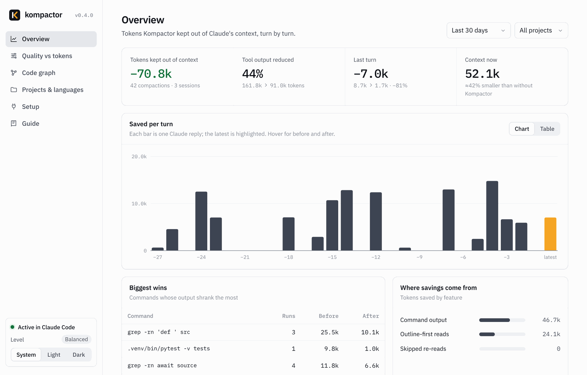
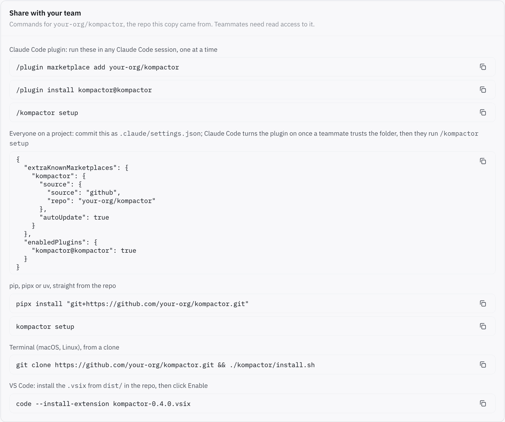
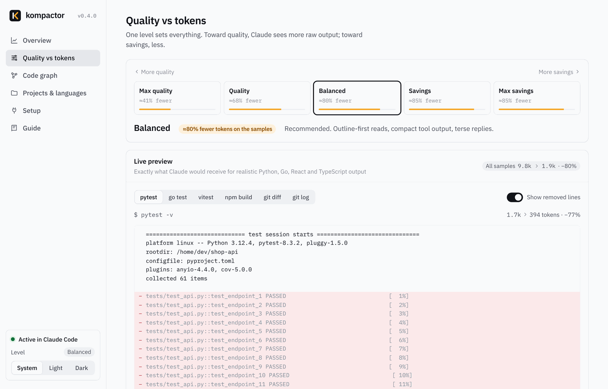
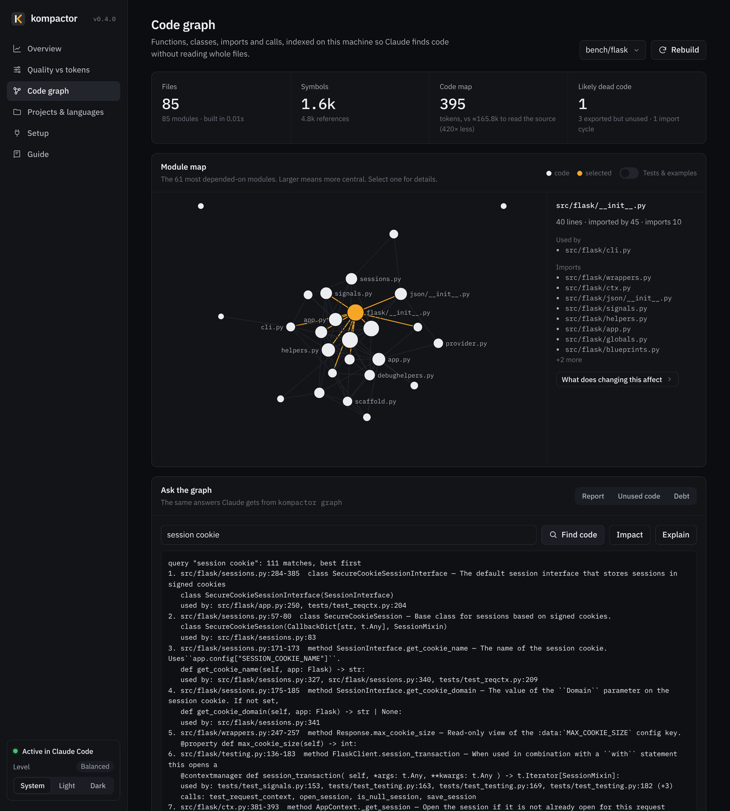
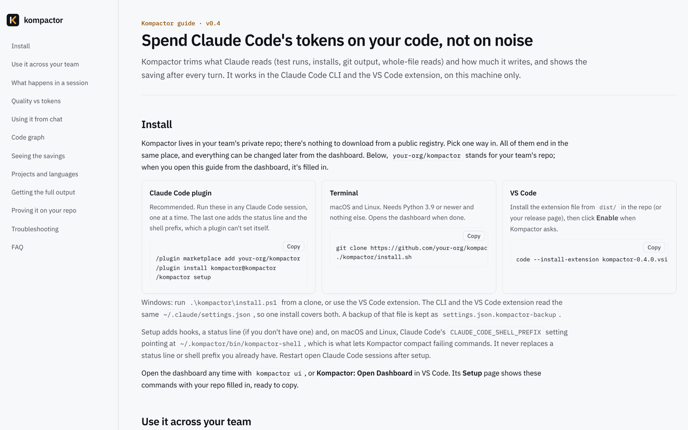

<p align="center">
  <picture>
    <source media="(prefers-color-scheme: dark)" srcset="docs/brand/kompactor-logo-dark.png">
    
  </picture>
</p>

<p align="center"><b>Cut the tokens Claude Code spends on noise.</b><br>
Choose quality vs tokens on a dashboard, and see what every turn saved.</p>

<p align="center">Claude Code CLI and VS Code · Python, Go, TypeScript, React · Python standard library only · MIT</p>

---

Most of a Claude Code session's tokens aren't your prompt or Claude's answer. They're tool output: test runs, installs, `git log`, whole-file reads. That output is sent again on every later turn until the context is compacted. Kompactor shrinks it before Claude reads it. It keeps every error, failing test, your own stack frames and the summary lines. It also gives Claude a local code graph and short rules for terser replies and smaller diffs.

**Measured in real Claude Code sessions** on Flask, Cobra, SWR, ky and zustand: **−16% tokens, −10% cost, −22% output tokens** at the default level, with the same answers (27/27 correct with and without).
Failing test runs and code search saved the most: **−33% tokens** on a Go test failure, **−32%** finding code in a TypeScript repo, and **−37% cost** on a vitest failure.
[Full results](#evidence)



## Install

Kompactor lives in your team's private repo; nothing is published to a public registry. In the commands below, `your-org/kompactor` stands for that repo. The dashboard's **Setup › Share with your team** panel shows the same commands with your repo filled in, ready to copy.

**Claude Code plugin** (recommended). Run these in any Claude Code session, one at a time:
```
/plugin marketplace add your-org/kompactor
/plugin install kompactor@kompactor
/kompactor setup
```
The last step adds the status line and the shell prefix that compacts failing commands, which a plugin can't set itself. Restart Claude Code afterwards.

**Terminal** (macOS, Linux; needs Python 3.9+ and nothing else). Opens the dashboard when done:
```bash
git clone https://github.com/your-org/kompactor.git && ./kompactor/install.sh
```
Windows: run `.\kompactor\install.ps1` from the clone.

**pip, pipx or uv**, straight from the repo (each person's git access is enough; nothing is published):
```bash
pipx install "git+https://github.com/your-org/kompactor.git"     # or: uv tool install "git+https://…"
kompactor setup
```

**VS Code.** Install the extension file from [`dist/`](dist/) (`code --install-extension kompactor-0.4.0.vsix`, or Extensions › `⋯` › *Install from VSIX…*), then click **Enable** when Kompactor asks. The status bar starts showing savings.

The CLI and the VS Code extension read the same `~/.claude/settings.json`, so one install covers both. Setup adds Kompactor's hooks, a status line (only if you don't have one) and the `/kompactor` skill. On macOS and Linux it also sets `CLAUDE_CODE_SHELL_PREFIX`. It never replaces a status line or shell prefix you already have, and it keeps a backup in `settings.json.kompactor-backup`. `kompactor install --uninstall` removes all of it.

## Use it across your team



Keep Kompactor in a private repo your teammates can read (an organisation repo is easiest). Every install method above pulls from it with each person's own git access, so there are no tokens to share.

| Way | Who it's for | What each person does | Updating |
|---|---|---|---|
| **Plugin** | Everyone on Claude Code (CLI or VS Code) | The three commands above, once | Automatic with `autoUpdate` (below); or `claude plugin marketplace update kompactor`, then `claude plugin update kompactor@kompactor` |
| **Project settings** | Everyone who works in a given repo | Trust the project folder when Claude Code asks, then `/kompactor setup` once; you commit the snippet below | Same as the plugin |
| **pip / pipx / uv** | People who manage Python tools that way | `pipx install "git+https://github.com/your-org/kompactor.git"`, then `kompactor setup` | `pipx upgrade kompactor` |
| **Terminal install** | Scripted machine setup, or people who don't use plugins | `git clone … && ./kompactor/install.sh` | `git pull`, then run `./install.sh` again |
| **VS Code extension file** | VS Code users who want the status bar and dashboard inside VS Code | Install the `.vsix` from `dist/` | Install the newer `.vsix` |

**Offer it in a project.** Commit this as `.claude/settings.json` in any repo your team works in:
```json
{
  "extraKnownMarketplaces": {
    "kompactor": { "source": { "source": "github", "repo": "your-org/kompactor" }, "autoUpdate": true }
  },
  "enabledPlugins": { "kompactor@kompactor": true }
}
```
When a teammate opens the project and accepts Claude Code's prompt to trust the folder, Claude Code adds the marketplace and turns the plugin on. Each person then runs `/kompactor setup` once (plugins can't set the status line or the shell prefix themselves). `autoUpdate` keeps everyone on your latest release; teammates get a new version when `version` in `.claude-plugin/plugin.json` changes, and `python scripts/bump_version.py 0.4.1` bumps it everywhere. `claude plugin marketplace add your-org/kompactor --scope project` writes the marketplace entry for you.

**Private-repo access.** Claude Code uses each person's existing git login and can't prompt for a password. An SSH key that works with GitHub is enough. Without one, run `gh auth login` and `gh auth setup-git`, and set `CLAUDE_CODE_PLUGIN_PREFER_HTTPS=1`.

**Set the team's level for a repo.** Commit a `.kompactor.json` next to the code:
```json
{ "preset": 4, "overrides": { "never_compact": ["terraform plan"] } }
```
`preset` is the level (1 Max quality to 5 Max savings); `overrides` sets any option by the names in `kompactor config`. A repo's file beats each person's global level, and each person's own choice for that project still wins. The dashboard's **Projects** page shows which repos have team settings.

**Script it.** The plugin commands also work outside the chat, for onboarding scripts:
```bash
claude plugin install kompactor --marketplace your-org/kompactor   # Claude Code 2.1.292+; older:
claude plugin marketplace add your-org/kompactor && claude plugin install kompactor@kompactor
```
**Roll out to every machine (admins).** Managed settings take the same `extraKnownMarketplaces` and `enabledPlugins` keys: `/Library/Application Support/ClaudeCode/managed-settings.json` on macOS, `/etc/claude-code/managed-settings.json` on Linux and WSL, `C:\Program Files\ClaudeCode\managed-settings.json` on Windows, or the managed settings in your claude.ai organisation. `strictKnownMarketplaces` limits people to approved marketplaces, such as `{ "source": "github", "repo": "your-org/*" }`.

**Plain `pip install kompactor`?** That needs a package index. Public PyPI would make the code public (the name `kompactor` is free there today). To keep it private, build the wheel with `pip wheel --no-deps .` and upload it to a private index your company already runs, such as Artifactory, AWS CodeArtifact, Google Artifact Registry or Gemfury. Teammates who point pip at that index can then run `pip install kompactor`.

## What it does

| When | Kompactor | How |
|---|---|---|
| Claude runs a command | Drops passing tests, progress bars, download chatter, library stack frames and lock-file diffs. Keeps errors, failures, your frames and summaries. The raw output is stashed (`kompactor show <id>`). | `PostToolUse` hook |
| A command **fails** | Claude Code skips output hooks when a command exits non-zero, and cuts the output to its first and last ~5K characters, usually losing the failures at the end. Kompactor's shell prefix runs tests, builds, linters and installs to completion, compacts them, and passes the exit code through. Your permission rules still apply to Claude's original command. | `CLAUDE_CODE_SHELL_PREFIX` |
| A command prints over ~30K chars | Claude Code saves it to a file and shows Claude a 2 KB preview. Kompactor compacts the whole saved output instead. | `PostToolUse` hook |
| Claude opens a big source file | Returns its outline first: symbols with line ranges, signatures, who imports it and which tests cover it. Claude then reads only what it needs, and repeating the read returns the whole file. Unchanged re-reads get a one-line note. | `PreToolUse` hook |
| Claude first searches or reads code | A budgeted map of the most depended-on modules, given once (sessions that only run commands don't pay for it). | `PostToolUse` context |
| Anytime | A local code graph for Python, Go, TypeScript, JavaScript and React: find code by topic, callers, impact of a change with the tests to run, import cycles, dead code. | `kompactor graph …`, dashboard |
| Every reply, subagents too | Two dials. Prose: answer first, no preamble or recap. Code: change nothing if possible, reuse before writing, smallest diff, one focused test, never cut validation or security. 0 to 177 tokens of rules, depending on level. | `SessionStart`, `SubagentStart` |
| After each turn | What the turn saved, in the reply, the CLI status line, the VS Code status bar and the dashboard. | `Stop` hook |

Kompactor never changes what a command does. It can't strand Claude: every trimmed output has a raw copy, and every blocked read is "deny once, allow on retry". Every hook fails open.

## Quality vs tokens



One level sets every option. Every option can also be changed on its own, globally or per project, on the dashboard. There's no config file to edit.

| Level | What Claude gets | Rules injected |
|---|---|---:|
| 1 Max quality | Almost everything. Only outputs over ~1.5k tokens are touched, and only pure noise is removed. Failing commands are compacted too, gently. | 0 |
| 2 Quality | Noisy commands compacted, passing tests hidden, one-line `git log`, outlines for files over 800 lines. Answer-first replies. | 72 |
| 3 **Balanced** (default) | Outlines from 400 lines, library frames trimmed, a 500-token code map, lean-code rules. | 156 |
| 4 Savings | Tighter caps, 3 lines of diff context, outlines from 250 lines, test-runner banners dropped, shorter prose. | 176 |
| 5 Max savings | 80-line caps, 1 line of diff context, outlines from 150 lines, telegraphic prose. | 177 |

Change the level from the dashboard (`kompactor ui`, or **Kompactor: Open Dashboard** in VS Code), the VS Code status bar, or in Claude Code chat (`/kompactor max savings`, `/kompactor balanced`). A repo can have its own level under **Projects & languages**.

## See the savings, per turn

| Where | What you see |
|---|---|
| Claude Code, after each reply | `Kompactor: −8.2k tokens this turn (13.1k › 4.9k, −63%) · session −41k · context ≈31% smaller` |
| CLI status line | `Kompactor −41.3k · ctx −31% · last turn −8.2k · Balanced` |
| VS Code status bar | Running savings. Each turn flashes its saving, and hovering shows details. |
| Dashboard | Per-turn chart, biggest wins, savings by feature and by project. |
| `kompactor estimate` | Replays your past sessions through the current settings: the share of tool output, billed tokens and cost Kompactor would have saved. |

The numbers are conservative. Savings count only what Claude would really have read. When Claude Code would have truncated an output anyway, only the truncated size counts. When Claude reads a whole file after its outline, the outline's saving is reversed.

## Code graph



`kompactor graph build` indexes a repo in about a second (Flask: 85 files in 0.33 s). It runs in the background at session start and after edits. Nothing is sent anywhere and nothing is written to the repo.

```
kompactor graph query "session cookie"     find code by topic, with line ranges and who uses it
kompactor graph impact createStore         files that use it, files that only import its module, tests to run
kompactor graph explain Name               one symbol: signature, callers, callees, tests
kompactor graph callers / deps / path      who calls it, what it imports, how two modules connect
kompactor graph report                     core modules, entry points, import cycles, tests by module
kompactor graph unused                     dead-code candidates (exported-but-unused listed separately)
```

`/kompactor review`, `/kompactor audit` and `/kompactor debt` in chat use the graph to find duplicated helpers, dead code and shortcuts.

## How it compares

Kompactor borrows the best idea from each of these tools: graphify's code graph, ponytail's lean-code ladder, caveman's terse prose, rtk's command filters, context-mode's raw-output stash, and the symbol-level reads of token-savior and code-review-graph. It then fixes the gaps that independent tests found. Researched in October 2026 from each project's repo and the independent tests linked below.

**Features** (Yes, Partly, or —):

| | Kompactor | [graphify](https://github.com/Graphify-Labs/graphify) | [ponytail](https://github.com/DietrichGebert/ponytail) | [caveman](https://github.com/JuliusBrussee/caveman) | [rtk](https://github.com/rtk-ai/rtk) | [token-savior](https://github.com/Mibayy/token-savior) | [context-mode](https://github.com/mksglu/context-mode) | [code-review-graph](https://github.com/tirth8205/code-review-graph) |
|---|---|---|---|---|---|---|---|---|
| Compacts command output | **Yes**, incl. failing runs | — | — | Partly (v4 proxy) | Yes, 100+ commands | Partly (opt-in) | Yes (sandbox) | — |
| Outline / symbol-level reads | **Yes**, automatic | Partly (strict mode) | Partly | Partly | Partly (`rtk read`) | Yes (MCP) | — | Yes (MCP) |
| Code graph and change impact | **Yes** (Py, Go, TS, React) | Yes, plus docs and images via an LLM | — | — | — | Yes | — | Yes |
| Terse-prose rules | **Yes**, 4 levels | — | Partly | Yes | — | — | — | — |
| Lean-code rules | **Yes** | — | Yes | Partly | — | Partly | — | — |
| Quality vs tokens control | **Yes**: 5 levels, every option, per project | Flags and env vars | 3 levels | Levels | TOML | Profiles | — | Partly |
| Per-turn savings shown | **Yes**: reply, status line, VS Code, dashboard | — | Partly (not in VS Code) | — | On demand (`rtk gain`) | — | Yes | Partly |
| Settings dashboard | **Yes** | Graph export | Yes | Partly | Partly | Yes | Hosted | Partly |
| VS Code | **Yes**, with its own extension | Yes | Partly | Yes | Yes | Partly | Yes | Yes |
| Real A/B evidence in the repo | **Yes**, with cost and correctness | Corpus ÷ answer ratio | Yes | Yes | — | Withdrawn, then partial | — | Upper bound |
| Dependencies | **None** (Python 3.9+ stdlib) | Python 3.10+, LLM for docs | Node | npm CLI, telemetry on by default | Rust binary | pip, MCP | MCP server (ELv2) | pip, tree-sitter |

**What happened when others measured them:**

| Tool | Activation in practice | Its own instructions | Independent result |
|---|---|---|---|
| **Kompactor** | Hooks act on every tool call, so Claude doesn't have to choose to use them | 0–177 tokens of rules + a 63-token skill entry | −16% tokens, −10% cost, 27/27 correct ([evidence](#evidence); self-run, reproducible with `kompactor prove`) |
| graphify | Nudges Claude to query the graph. An 87-session analysis found 4% of nudges followed; the nudges cost about 651k tokens against 176k from graphify's own answers ([#3435](https://github.com/Graphify-Labs/graphify/issues/3435)) | ~11k-token skill | 7.3× on code-only questions in one test. The 71.5× headline divided the whole corpus by one answer and has been dropped from its README |
| ponytail | Hooks inject its rules. As a plain skill it activated in 0 of 10 runs | Rules + a codebase map at each start | Cost −10.3%, code −15%, quality unchanged ([JetBrains](https://blog.jetbrains.com/ai/2026/07/ponytail-skill-claude-tested/), ~80 tasks) |
| caveman | Hooks inject its rules | ~1,160 tokens | Output −8.5%, cost ≈ −10% per task ([JetBrains](https://blog.jetbrains.com/ai/2026/07/speak-to-ai-agents-like-cavemen-tosave-tokens/)) |
| rtk | A hook rewrites commands; the rewrites bypass permission rules (rtk #4644) | None | Cost +7.6% at low effort, ±0% at high ([JetBrains](https://blog.jetbrains.com/ai/2026/07/rtk-claude-code-token-savings/), 86 tasks). `rtk gain` counts all raw output, and reported 96.2M tokens saved while the bill rose |
| token-savior | Only when Claude calls its MCP tools: 1 of 143 sessions in a re-measurement it later withdrew | ~1.5k tokens of tool schemas (15 tools) and up | −43% tokens, −13% cost in one run ([computingforgeeks](https://computingforgeeks.com/reduce-claude-code-token-usage-tools/)) |
| context-mode | Hooks route big outputs into its sandbox; retrieval is via MCP | 11 tool schemas | No independent measurement found |
| code-review-graph | Only when Claude calls its MCP tools | 30 tool schemas | −5% in one run ([computingforgeeks](https://computingforgeeks.com/reduce-claude-code-token-usage-tools/)) |

**Where Kompactor is better**
- **It works without being asked.** Graph tools and MCP servers save nothing when Claude doesn't call them, and the data above shows how often that happens. Kompactor's savings come from hooks on every tool call. In the A/B runs, Claude never had to run a Kompactor command for them to apply.
- **It handles the failing run.** That's where the noisiest output is, and where Claude Code itself drops the useful part. rtk handles failures too, but by rewriting commands, which bypasses your permission rules. Kompactor acts after the permission check, on Claude's original command, with the exit code unchanged.
- **Its own instructions are small.** 156 tokens at the default level, against ~1,160 for caveman and an ~11k-token skill for graphify. The code map only appears once Claude starts exploring code.
- **Its savings numbers are honest.** It counts what Claude would actually have read, not raw output size, and it reverses a saving when Claude reads the full file anyway.
- **It's proven on cost and correctness, not just token counts.** `kompactor prove` reruns the same tasks with and without Kompactor in real Claude Code sessions, and the results are in this repo.
- **One control covers every layer**, from a dashboard, with a live preview of exactly what Claude would see.

**Where others are stronger**
- graphify builds a multimodal graph: docs, PDFs and images through an LLM, about 40 languages, Obsidian and Neo4j exports. Kompactor's graph covers Python, Go, TypeScript, JavaScript and React code only.
- rtk has native filters for 100+ commands at under 10 ms each. Kompactor's filters cover the common dev commands and run in Python (50–100 ms per hook).
- context-mode runs code in a sandbox and indexes huge outputs such as Playwright snapshots. token-savior keeps memory across sessions. Kompactor does neither.

## Evidence

`kompactor prove` runs each task in real headless Claude Code sessions (`claude -p`). Each task runs 3 times without Kompactor and 3 times with it, interleaved, with the same prompt, tools, turn limit and budget cap. Kompactor runs as an installed plugin at the default level. Tokens are input + cache writes + cache reads + output across every API call, and cost is Claude Code's own figure.

| Task | Repo | Tokens | Cost | Turns | Correct (without › with) |
|---|---|---:|---:|---|---|
| Find the failing Go test and its error | Cobra | **−33%** | **−18%** | 3.3 › 2.0 | 3/3 › 3/3 |
| Find how requests are deduplicated | SWR | **−32%** | −12% | 3.0 › 2.0 | 3/3 › 3/3 |
| Find where the session cookie is signed | Flask | **−26%** | −11% | 3.7 › 2.7 | 3/3 › 3/3 |
| Find the flag-group validation function | Cobra | −24% | −6% | 2.7 › 2.3 | 3/3 › 3/3 |
| Most-changed files in the last 40 commits | Flask | −16% | +4% | 3.7 › 3.0 | 3/3 › 3/3 |
| Find the failing vitest test (`--reporter=verbose`) | zustand | −7% | **−37%** | 2.0 › 2.0 | 3/3 › 3/3 |
| Type-check and list errors | ky | +1% | −2% | 2.0 › 2.0 | 3/3 › 3/3 |
| Find the failing pytest tests | Flask | +1% | +3% | 2.0 › 2.0 | 3/3 › 3/3 |
| What does changing `createStore` affect | zustand | +17% | +4% | 2.0 › 2.3 | 3/3 › 3/3 |
| **Total (54 sessions)** | | **−16%** | **−10%** | | **27/27 › 27/27** |

The same 27 Kompactor sessions were also run at both ends of the quality-vs-tokens range, against the same baseline:

| Level | Tokens | Cost | Output tokens | Correct |
|---|---:|---:|---:|---|
| 1 Max quality | +3% | −1% | 0% | 27/27 |
| 3 Balanced (default) | **−16%** | **−10%** | **−22%** | 27/27 |
| 5 Max savings | −12% | −10% | −22% | 27/27 |

What the numbers show:
- **The wins come from avoided turns.** Every turn re-sends the whole context. The vitest failure was 32K characters of passing tests; Kompactor handed Claude 1K characters with the failure, at 37% lower cost. On the Go failure, Claude got the answer in one run instead of piping through `tail` and `grep` three or four times. On code search, the code map and outlines saved a turn.
- **Levels show up per command more than per session.** Max quality barely touches output, so it's close to neutral. Balanced and Max savings land within run-to-run noise of each other here, because most of every session is Claude Code's own fixed context, and turns saved matter more than how hard each output is squeezed. The difference shows per command (next table).
- **Short sessions pay a small fixed cost.** On 2-turn tasks whose output was already small, Kompactor's rules and skill entry add about 1%. One of three `createStore` runs took an extra turn, which is the +17%.
- **Two experiments shaped the defaults.** Telling Claude not to pipe output through `tail` cost **+33%** tokens before the shell prefix existed, and **−9%** with it, so that rule is only on while the prefix is active. An earlier Max-savings round lost 2 of 27 answers when the 80-line cap cut a list Claude had asked for with `git log --format`; output Claude shapes itself is now kept verbatim ([notes](evidence/README.md)).

Full report: [evidence/REPORT.md](evidence/REPORT.md). Every session's tokens, tool calls and answers: [evidence/results.json](evidence/results.json). To see exactly what Claude received in each arm for the same failing test run (15,617 vs 1,039 characters), read [evidence/EXAMPLE.md](evidence/EXAMPLE.md).

### Command output, measured directly

Tokens Claude receives for single commands on real repos (`bench/bench.py`):

| Repo | Command | Raw | Balanced | Max savings |
|---|---|---:|---:|---:|
| Flask | `pytest -v tests` (1 failure, 482 passed) | 9,842 | 1,138 (**−88%**) | 696 (**−93%**) |
| Flask | `grep -rn 'def ' src` | 8,492 | 3,230 (−62%) | 1,323 (−84%) |
| Flask | `git log -n 40` | 1,457 | 598 (−59%) | 598 (−59%) |
| ky | `npm install` (fresh) | ~33,000 | 469 (**−99%**) | 451 (−99%) |
| ky | `grep -rn await source` | 2,938 | 1,653 (−44%) | 1,058 (−64%) |
| Flask | Read `src/flask/app.py` (1,625 lines) › outline | 14,084 | 1,490 (−89%) | 1,490 (−89%) |
| ky | Read `source/core/Ky.ts` (1,376 lines) › outline | 12,452 | 919 (−93%) | 919 (−93%) |

## Languages

Kompactor detects each repo's languages (`pyproject.toml` › Python, `go.mod` › Go, `tsconfig.json`/`package.json` › TypeScript, a `react` or `next` dependency › React). You can also pin them in the dashboard.

| | Python | Go | TypeScript / React |
|---|---|---|---|
| Library stack frames collapsed | `site-packages`, stdlib, `.venv` | `GOROOT`, `runtime/`, `pkg/mod` | `node_modules`, `node:internal`, `react-dom`, `next/dist` |
| Generated files (outline instead of a full read) | `*_pb2.py`, migrations | `*.pb.go`, `*_gen.go`, `zz_generated*`, mocks | `*.d.ts`, `*.min.js`, `dist/`, `.next/` |
| Lock files collapsed in diffs | `poetry.lock`, `uv.lock`, `Pipfile.lock` | `go.sum` | `package-lock.json`, `yarn.lock`, `pnpm-lock.yaml` |
| Test runners | pytest, unittest, tox, nox | `go test`, gotestsum | jest, vitest, mocha, playwright |
| Code graph | `ast`: classes, functions, decorators, imports, calls | packages, structs, interfaces, methods | components, hooks, JSX renders, `tsconfig` paths, workspace packages |

## Commands

```
kompactor setup                   enable for Claude Code (CLI + VS Code) and open the dashboard
                                  (plugin installs: /kompactor setup in Claude Code)
kompactor ui                      the dashboard
kompactor presets                 list levels        kompactor config preset 4    change level
kompactor gain                    savings so far     kompactor estimate           replay past sessions
kompactor graph <action>          query, impact, explain, callers, deps, path, report, unused
kompactor show ID / search TEXT   raw outputs Kompactor compacted
kompactor prove                   A/B test Kompactor in real Claude Code sessions
kompactor doctor                  check the installation (the dashboard's self-test runs every hook)
kompactor install --uninstall     remove hooks, status line and shell prefix
```

The [usage guide](docs/usage.html) covers setup, team rollout, levels, the graph, troubleshooting and FAQs. It's also built into the dashboard as **Guide**.



## Development

```bash
python -m unittest discover tests     # 78 tests, including the real shell prefix run as Claude Code runs it
node vscode/test/smoke.js             # VS Code extension against a mock API
./scripts/build-vsix.sh               # › dist/kompactor-<version>.vsix
python -m kompactor prove --tasks bench/tasks.json --repos <folder with the bench repos> --reps 3
```

How Claude Code's hooks behave on success, failure and very long output, and why Kompactor uses a shell prefix rather than rewriting commands, is written up in [docs/SPEC.md](docs/SPEC.md).

**About the name.** Kompactor was called Kompact until version 0.4. It was renamed because an unrelated PyPI package, `kompact`, installs a `kompact` command, and Claude could have run that one instead. Installing Kompactor replaces an old Kompact install's hooks, status line, shell prefix and skill, and leaves other tools' settings alone.

MIT licensed.
