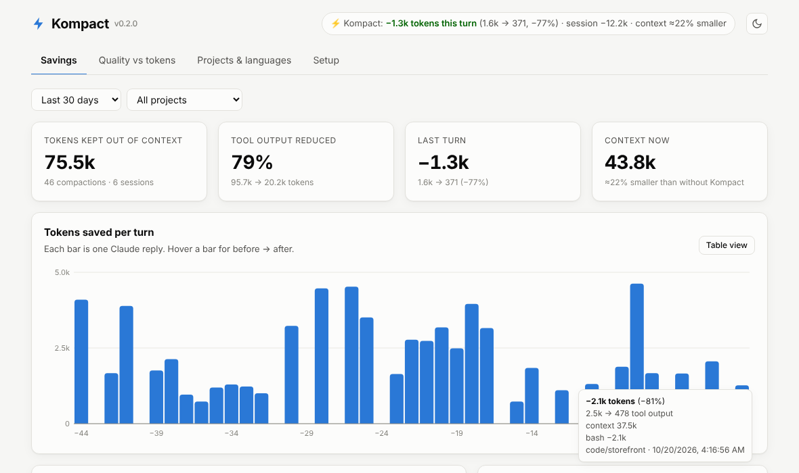
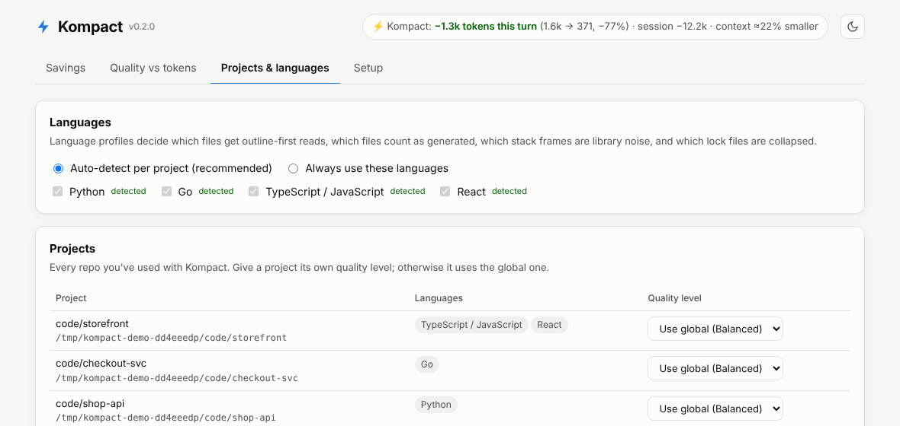

# Kompact

**Cut the tokens Claude Code spends on noise. Choose your quality vs tokens trade-off from a dashboard, and see the savings after every turn.**

Works with **Claude Code in VS Code** and the **Claude Code CLI**: both read `~/.claude/settings.json`, so one setup covers both. Tuned for **Python, Go, TypeScript and React** repos, with automatic language detection.



Most of a Claude Code session's tokens aren't your prompt or Claude's answer. They're tool output: test runs, `npm install`, `git log`, whole-file reads. That output is sent again on **every later turn** until the context is compacted. Kompact shrinks it before Claude sees it, and always keeps errors, failing tests, your own stack frames and summaries.

## Install (pick one, about a minute)

**VS Code** (recommended if you use Claude Code in VS Code)
1. Download [`dist/kompact-0.2.0.vsix`](dist/kompact-0.2.0.vsix) (or build it: `./scripts/build-vsix.sh`).
2. In VS Code: Extensions → `⋯` → **Install from VSIX…**
3. Click **Enable** when Kompact asks. Done: the status bar now shows your savings.

**Terminal** (macOS / Linux, or Windows PowerShell)
```bash
curl -fsSL https://raw.githubusercontent.com/amarkum/Kompact/main/install.sh | sh
```
```powershell
irm https://raw.githubusercontent.com/amarkum/Kompact/main/install.ps1 | iex
```
This enables Kompact for Claude Code and opens the dashboard. No pip and no dependencies; it only needs Python 3.9+.

**Claude Code plugin**
```
/plugin marketplace add amarkum/Kompact
/plugin install kompact@kompact
```

Every option ends up in the same place, and you change everything later from the **dashboard**. There's no config file to edit.

## Quality vs tokens: one slider


| Level | Name | What Claude gets | Sample savings* |
|---|---|---|---:|
| 1 | Max quality | Almost everything. Only outputs over ~1.5k tokens are touched, and only pure noise (download logs, progress bars, lock-file diffs) is removed. | 41% |
| 2 | Quality | Noisy commands compacted. Passing tests hidden, one-line git log, big files still read whole up to 800 lines. | 68% |
| 3 | **Balanced** (default) | Outline-first reads for files over 400 lines, library stack frames trimmed, terse-reply rules. | 80% |
| 4 | Savings | Tighter caps, 3 lines of diff context, outline from 250 lines, test-runner banners dropped. | 85% |
| 5 | Max savings | Most aggressive: 80-line cap, 1 line of diff context, outline from 150 lines, terse + minimal-code reply style. Beats level 4 on long outputs and big files. | 85% |

\*Measured on the bundled realistic samples (pytest failure, `go test` panic, vitest failure, `npm install && build`, `git diff` with a lock file, `git log`). The dashboard's **live preview** shows exactly what Claude would see for each sample as you move the slider.

**Change the level from anywhere:**
- The dashboard slider (`kompact ui`, or **Kompact: Open Dashboard** in VS Code)
- The VS Code status bar → **Choose quality vs tokens level**
- Inside Claude Code chat: `/kompact max savings`, `/kompact balanced`, `/kompact show savings`
- Per project: give a repo its own level in **Projects & languages**
- Every individual setting is under **Advanced settings**, each with a "reset to preset"

## See the savings, per turn

| Where | What you see |
|---|---|
| In Claude Code, after each reply | `⚡ Kompact: −8.2k tokens this turn (13.1k → 4.9k, −63%) · session −41k · context ≈31% smaller` (a `Stop`-hook message; where VS Code renders hook messages isn't documented, so the extension's status bar shows it too) |
| VS Code status bar | `⚡ −41.3k · ctx −31%`. Each new turn flashes its savings; hover for details. |
| CLI status line | `⚡ Kompact −41.3k · ctx −31% · last turn −8.2k · Balanced` |
| Dashboard | Per-turn chart (hover for before → after), biggest wins, savings by feature, per project |
| `kompact estimate` | Replays your past Claude Code sessions: the % of tool output, billed tokens and cost Kompact would have saved |

"Context ≈31% smaller" compares the context Claude actually carries now against what it would carry without Kompact, counting everything trimmed since the last compaction.

## Languages



Kompact detects each repo's languages (`pyproject.toml` / `requirements.txt` → Python, `go.mod` → Go, `tsconfig.json` / `package.json` → TypeScript, a `react` / `next` dependency → React). You can also pin languages in the dashboard. Each profile knows:

| | Python | Go | TypeScript / React |
|---|---|---|---|
| Library stack frames collapsed | `site-packages`, stdlib, `.venv` | `GOROOT`, `runtime/`, `pkg/mod` | `node_modules`, `node:internal`, `react-dom`, `next/dist` |
| Generated files (outline instead of reading) | `*_pb2.py`, migrations | `*.pb.go`, `*_gen.go`, `zz_generated*`, mocks | `*.d.ts`, `*.min.js`, `dist/`, `.next/`, `__generated__` |
| Lock files collapsed in diffs | `poetry.lock`, `uv.lock`, `Pipfile.lock` | `go.sum` | `package-lock.json`, `yarn.lock`, `pnpm-lock.yaml` |
| Test runners | pytest, unittest, tox, nox | `go test`, gotestsum | jest, vitest, mocha, playwright, `npm test` |
| Build/install noise | pip, uv, poetry | `go: downloading` | npm, pnpm, yarn, vite, next, webpack |

Example: a Python traceback through Flask, Werkzeug and your code becomes your frames plus `[… 11 library frames hidden …]` and the frame that raised. A Go panic keeps `cart.go:58` and drops the `testing`/`runtime` frames.

## How it works

| Hook | What Kompact does | Inspired by |
|---|---|---|
| `PostToolUse` (Bash) → `updatedToolOutput` | Command-aware compaction: git, test runners, package managers, builds, `find`/`ls -R`, grep/rg. Errors are kept from the middle of truncated output. Raw output is stashed locally (`kompact show <id>`). | rtk, context-mode |
| `PreToolUse` (Read) | First full read of a big source file returns its **outline** (functions, classes, methods with `[L120-184]` ranges). **Reading again returns the whole file.** Unchanged re-reads get a one-line note, once. | graphify, token-savior, aider, repomix |
| `SessionStart` | Reply-style rules for the level: no preamble or recaps; minimal code at level 5. | caveman, ponytail, claude-token-efficient |
| `Stop` | Totals the turn's savings for the reply note, the status lines and the dashboard. | |

Design choices:
- **Commands run exactly as typed.** Kompact changes only what Claude *reads*, never your commands or permissions (unlike tools that rewrite commands).
- **Never a dead end.** Every block is "deny once, allow on retry"; every trimmed output points to its raw copy. Prefix a command with `KOMPACT_RAW=1` to skip compaction. Every hook fails open.
- **Honest numbers.** If Claude reads the whole file anyway, the claimed saving is reversed. The estimator weights each removed token by how many later API calls would have re-sent it.
- **Private and dependency-free.** Python stdlib only. The dashboard binds to `127.0.0.1` and requires a per-launch token for changes. Nothing leaves your machine.

## Measured on real repos

Tokens Claude receives, before and after Kompact, at two levels:

| Repo | Command | Raw | Balanced | Max savings |
|---|---|---:|---:|---:|
| flask (Python) | `pytest -v tests` (1 failure, 482 passed) | 9,842 | 1,138 (**−88%**) | 696 (**−93%**) |
| flask | `grep -rn 'def ' src` | 8,492 | 3,230 (−62%) | 1,323 (−84%) |
| flask | `git log -n 40` | 1,457 | 598 (−59%) | 598 (−59%) |
| flask | `find . -type f` | 2,901 | 1,484 (−49%) | 1,431 (−51%) |
| ky (TypeScript) | `npm install` (fresh) | ~33,000 | 469 (**−99%**) | 451 (−99%) |
| ky | `grep -rn await source` | 2,938 | 1,653 (−44%) | 1,058 (−64%) |
| ky | `git log -n 40` | 1,918 | 882 (−54%) | 882 (−54%) |
| flask | Read `src/flask/app.py` (1,625 lines) → outline | 14,084 | 1,490 (−89%) | 1,490 (−89%) |
| ky | Read `source/core/Ky.ts` (1,376 lines) → outline | 12,452 | 919 (−93%) | 919 (−93%) |

Reproduce with `KOMPACT_PRESET=3 python bench/bench.py <repo> "<command>" …`.

## Commands

```
kompact setup              enable for Claude Code (CLI + VS Code) and open the dashboard
kompact ui                 open the dashboard
kompact presets            list quality levels       kompact config preset 4   change level
kompact gain               live savings              kompact estimate          replay past sessions
kompact map / outline FILE / symbol Name             cheap code navigation for Claude
kompact show ID / search QUERY                       raw outputs Kompact compacted
kompact install --uninstall                          remove hooks (a settings backup is kept)
kompact doctor                                       check the installation
```

## Landscape (October 2026)

| Tool | Layer | Independent result |
|---|---|---|
| [graphify](https://github.com/safishamsi/graphify) | knowledge-graph retrieval | 5–10× on codebase Q&A in one test; the 71.5× headline is best-case |
| [ponytail](https://github.com/dtrick/ponytail) | write less code | ~10% per task |
| [caveman](https://github.com/JuliusBrussee/caveman) | terse prose | −38% on one task; ~8.5% in another |
| [rtk](https://github.com/rtk-ai/rtk) | Bash output (rewrites commands) | 60–90% on noisy output |
| [token-savior](https://github.com/Mibayy/token-savior) | symbol-level reads (MCP) | −43% |
| [context-mode](https://github.com/mksglu/context-mode) | stash big outputs | not benchmarked |

Each covers one layer. Kompact combines the layers that compound, puts them behind one quality slider, and shows you the savings.

## Development

```bash
python -m unittest discover tests        # 38 tests
node vscode/test/smoke.js                # VS Code extension against a mock API
./scripts/build-vsix.sh                  # → dist/kompact-<version>.vsix
KOMPACT_HOME=/tmp/kd python scripts/demo.py && KOMPACT_HOME=/tmp/kd python -m kompact ui   # try the dashboard
```

MIT licensed.
